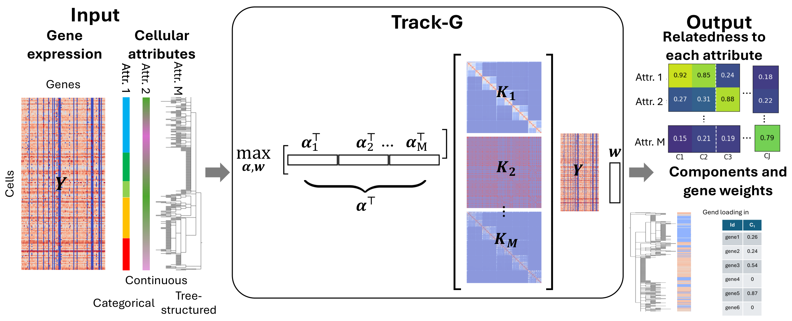

# TrackG

We developed `Track-G` to identify gene modules related to a flexible number and types of cellular attributes, such as position in the developmental lineage, cell type and spatial region. `Track-G` represents every cellular attribute by a cell-cell similarity matrix (kernel), so that categorical and continuous attributes and lineage trees are handled in the same way. Based on a multi-kernel non-negative canonical correlation analysis (CCA) framework, `Track-G` jointly infers gene modules and the relatedness of every module to every attribute, which delineates the attribute underlying each module through a soft assignment. The number of modules is chosen by parallel analysis. Applied to lineage-tracing data of mouse lung tumors (KP-Tracer), `Track-G` separated lineage-related from location-related gene modules and made fewer misassignments of genes to attributes than methods that consider one attribute at a time.

<br>



<br>

## Installation

```bash
git clone https://github.com/CM-Compbio-Group/TrackG.git
cd TrackG
conda env create -f environment.yml
conda activate trackg
python -m ipykernel install --user --name trackg --display-name trackg
```

Alternatively, you can follow these steps:

```bash
git clone https://github.com/CM-Compbio-Group/TrackG.git
cd TrackG
conda create -n trackg python=3.10
conda activate trackg
pip install numpy scipy pandas matplotlib seaborn anndata biopython networkx threadpoolctl
pip install jupyter jupyterlab ipykernel
python -m ipykernel install --user --name trackg --display-name trackg
```

`Track-G` is a Python package in `src/Track_G/` and needs no further installation: add `src/` to the Python path, as the tutorial notebooks do. Tested with Python 3.10, numpy 2.2, scipy 1.15, pandas 2.3, matplotlib 3.10, anndata 0.11 and biopython 1.85.

## How to Use

* Please refer to the tutorials, run from the `tutorial/` folder (outputs are written to `tutorial/results/`):
  * `tutorial/simulation.ipynb`: `Track-G` on simulated data with a lineage tree and a categorical cell type (about 2 min).
  * `tutorial/kptracer.ipynb`: `Track-G` on the KP-Tracer tumor family 3454_Lkb1_All, with the lineage tree and the tumor location as attributes (about 10 min). The raw data are included in `tutorial/data/kptracer/`.

* Basic usage:

```python
import sys
sys.path.insert(0, "src")
from Track_G import (filter_and_standardize_expression, build_kernel_matrix, run_parallel_analysis,
                     fit_witten_nonnegative_cca, gene_kernel_scores)

expr = filter_and_standardize_expression(log_exp)              # cells x genes log expression
K, _ = build_kernel_matrix(kernels, kernel_names)               # K = [K_1^1/2 | ... | K_M^1/2]
J = run_parallel_analysis(expr["X2_np"], K, nulls=("entrywise",)).J
fit = fit_witten_nonnegative_cca(K=K, X2_np=expr["X2_np"], KERNEL_NAMES=kernel_names, J=J)
p, s = gene_kernel_scores(fit["W2_matrix"], fit["all_scores"], expr["valid_genes"], kernel_names)
```
`p` is the relatedness of every component to every attribute, and `s` the score of every gene for every attribute.

## Repository structure

```
src/Track_G/              the Track-G package
    parallel_analysis.py  number of components J (permutation null on K^T X)
    CCA.py                nonnegative sparse multi-kernel CCA, kernel concatenation (K^1/2), gene scores, saving
    gene_filtering.py     gene filter + per-gene standardization
utils/                    wrappers of other methods (ALPINE, CoGAPS, Hotspot); not used by the tutorials
tutorial/
    data/kptracer/        raw KP-Tracer data of tumor family 3454_Lkb1_All (counts + lineage tree)
    kptracer/             data loader (expression, kernels) and evaluation / figures of the KP-Tracer analysis
    simulation/           simulated data and evaluation / figures of the simulation
    kptracer.ipynb        Track-G on KP-Tracer
    simulation.ipynb      Track-G on simulated data
```
